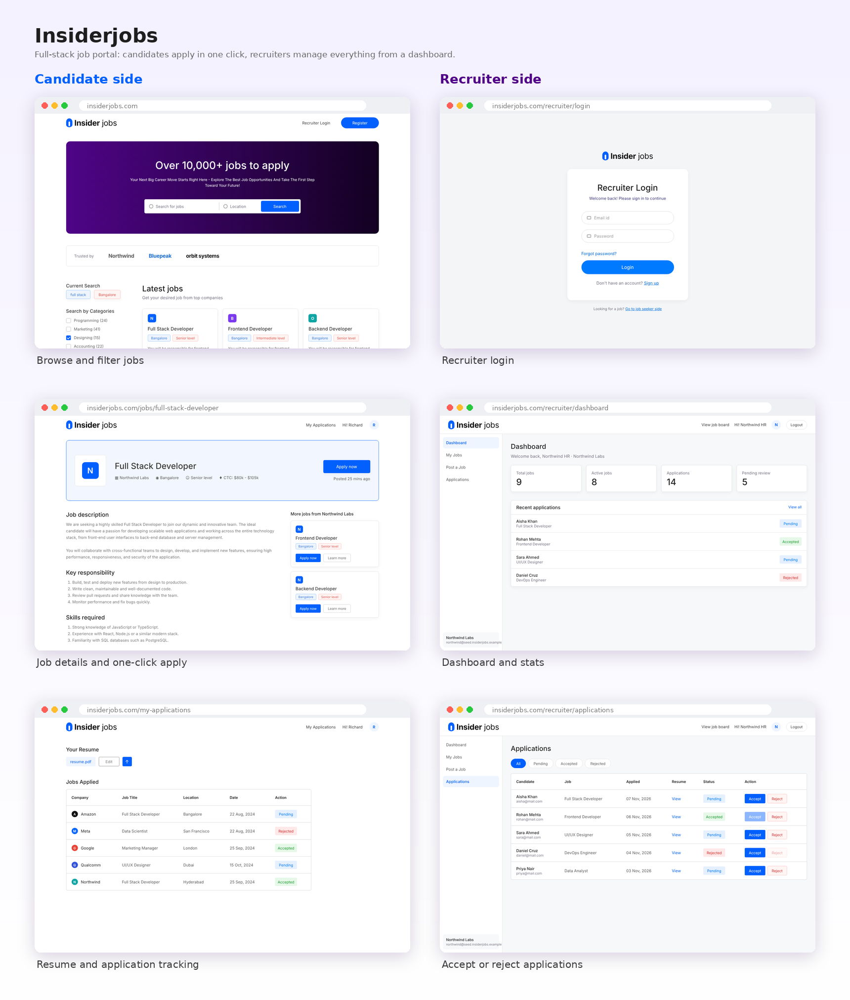

# Insiderjobs

A full-stack job portal built with Next.js. Candidates browse, filter and apply to jobs with one click. Recruiters sign up, verify their email, post jobs and manage applications from their own dashboard.



## Features

**Candidates**
- Sign up and sign in with Clerk (email verification handled by Clerk)
- Browse the latest jobs with search, category and location filters, and pagination
- Read full job details, including responsibilities and required skills
- Upload a resume once (PDF, max 5 MB) and replace it any time
- Apply with one click: the resume is sent to the recruiter automatically
- Duplicate applications are blocked in the UI, on the server and by a database constraint
- Track every application and its status (Pending, Accepted, Rejected) on `/my-applications`

**Recruiters**
- Separate custom authentication (bcrypt + signed httpOnly session cookie)
- Email verification through Brevo, then automatic login to the dashboard
- Forgot and reset password, with old sessions invalidated after a reset
- Post, edit, delete jobs and switch them between Active and Inactive
- Review applications per job, view resumes, and accept or reject candidates
- Candidates receive an email when their application is accepted or rejected

## Tech stack

| Area | Technology |
|---|---|
| Framework | Next.js (App Router), React, TypeScript |
| Styling | Tailwind CSS, Outfit font, Lucide icons |
| Database | PostgreSQL on Neon, Prisma ORM |
| Candidate auth | Clerk |
| Recruiter auth | Custom (bcryptjs, jose JWT) |
| Email | Brevo |
| File storage | Cloudinary (signed uploads) |
| Validation | Zod |

## Data model

- `Candidate`: linked to a Clerk user by `clerkId`, stores the current resume.
- `Recruiter`: custom account with hashed password and verification state.
- `Job`: belongs to a recruiter, with category, level, location, salary range and status.
- `Application`: links a candidate and a job, stores a snapshot of the resume and the status. It has a unique constraint on `(candidateId, jobId)`.
- `EmailVerificationToken` and `PasswordResetToken`: only SHA-256 hashes are stored.

Roles are not a column. A person is a candidate or a recruiter depending on which table they live in and which login they used.

## Getting started

### 1. Prerequisites
- Node.js 20 or newer
- A [Neon](https://neon.tech) database
- A [Clerk](https://clerk.com) application
- A [Cloudinary](https://cloudinary.com) account
- A [Brevo](https://brevo.com) account (optional in development)

### 2. Install

```bash
git clone <your-repo-url>
cd insiderjobs
npm install
```

### 3. Environment variables

Create a `.env` file in the project root:

```dotenv
# Database (Neon)
DATABASE_URL=

# Clerk (candidates)
NEXT_PUBLIC_CLERK_PUBLISHABLE_KEY=
CLERK_SECRET_KEY=
NEXT_PUBLIC_CLERK_SIGN_IN_URL=/sign-in
NEXT_PUBLIC_CLERK_SIGN_UP_URL=/sign-up

# Recruiter sessions and links
SESSION_SECRET=        # generate with: openssl rand -base64 32
APP_URL=http://localhost:3000

# Brevo (recruiter emails and status emails)
BREVO_API_KEY=
BREVO_SENDER_EMAIL=
BREVO_SENDER_NAME=Insiderjobs

# Cloudinary (resumes)
CLOUDINARY_CLOUD_NAME=
CLOUDINARY_API_KEY=
CLOUDINARY_API_SECRET=
NEXT_PUBLIC_CLOUDINARY_CLOUD_NAME=
```

Notes:
- Without `BREVO_API_KEY`, emails are printed in the terminal during development, so you can still test verification and reset links.
- `SESSION_SECRET` must be at least 32 characters.
- In Cloudinary, enable delivery of PDF files (Settings, Security) or resume links will not open.

### 4. Database

```bash
npx prisma migrate dev
npx prisma generate
```

### 5. Seed demo data (development only)

```bash
npm run db:seed          # create demo jobs, recruiters, candidates, applications
npm run db:seed:clean    # remove all demo data
```

Demo recruiter login: `northwind@seed.insiderjobs.example` / `Demo@12345`.
Use a development database or a Neon branch, never production. The seed script refuses to run when `NODE_ENV=production`.

### 6. Run

```bash
npm run dev
```

Open [http://localhost:3000](http://localhost:3000).

## Project structure

```
src/
  app/
    (site)/            Candidate side: home, job details, my-applications, sign-in/up
    recruiter/         Recruiter auth pages and the (dashboard) area
  actions/             Server actions (apply, resume, recruiter auth, recruiter jobs)
  components/          UI components (navbar, cards, tables, forms, loader)
  lib/                 Prisma client, queries, sessions, email, validation helpers
prisma/                Schema, migrations, seed script
public/assets/         Logos and icons
```

## Security notes

- Every server action validates input with Zod and checks the user on the server.
- Recruiter queries always filter by `recruiterId`, so one recruiter can never touch another's data.
- Duplicate applications are prevented by a database unique constraint, so double clicks and parallel requests are safe.
- Recruiter passwords are hashed with bcrypt. Verification and reset tokens are stored only as hashes and expire.
- Login responses are generic to avoid revealing which emails exist.
- Rate limiting is currently disabled (`src/lib/rate-limit.ts` allows every request). Add a real limiter before going to production.

## Deployment

1. Push the repository to GitHub and import it in Vercel.
2. Add all environment variables, using Clerk production keys and your real `APP_URL`.
3. Use the Neon pooled connection string for `DATABASE_URL`.
4. Run `npx prisma migrate deploy` against the production database.

## Roadmap

- Real rate limiting (Upstash or database based)
- Private resume delivery with signed, expiring URLs
- Company logo upload for recruiters
- Pagination for recruiter lists
- Clerk webhook to sync deleted users

## License

Choose a license for your project (for example MIT) and add a `LICENSE` file.